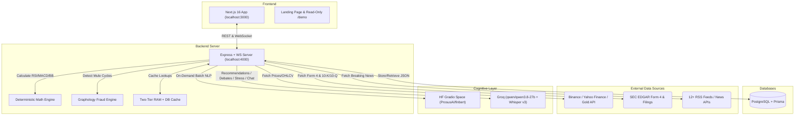
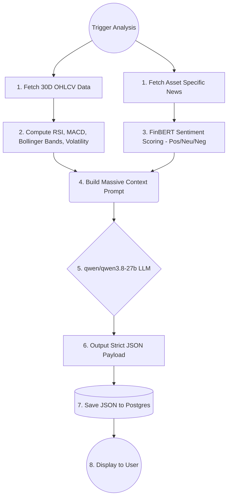

# Beacon (formerly known as FinPilot) 🚀

Beacon (formerly known as FinPilot) is an advanced, AI-driven portfolio management and market intelligence dashboard. It transcends basic price tracking by deploying a multi-model cognitive engine to synthesize technical market conditions, parse natural language news via Gradio-hosted FinBERT, detect SEC Form 4 insider clusters and money-mule rings, analyze earnings call vocal/linguistic stress, run historical DCA simulations, and provide highly opinionated, data-backed trading recommendations.

---

## 🏗️ System Design & Architecture

Beacon operates on a decoupled client-server architecture designed for high-frequency data ingestion, graph/statistical computation, and complex LLM orchestration.

### Core Tech Stack

*   **Frontend (`frontend/`)**: Next.js 16 (App Router), React 19, Tailwind CSS v4, Framer Motion, Recharts, `react-force-graph-2d`, Lucide-React.
*   **Backend (`backend/`)**: Node.js, Express, TypeScript, WebSocket (`ws`), `node-cron`, Graphology, `yahoo-finance2`.
*   **Database**: PostgreSQL managed via Prisma ORM (`JSON/JSONB` for unstructured AI payloads).
*   **Landing Page & Live Demo (`landing-page/`)**: Next.js 16 showcase with a self-contained, read-only interactive demo at `/demo`.
*   **AI / Machine Learning**:
    *   **LLM Engine**: `qwen/qwen3.8-27b` via Groq SDK for cognitive synthesis, multi-agent debates, chatbot RAG, and linguistic stress extraction.
    *   **Audio Transcription**: `whisper-large-v3` via Groq SDK for earnings call transcription.
    *   **NLP Engine (`finbret/` + `backend/src/models/finbert.model.ts`)**: `ProsusAI/finbert` hosted on a free Hugging Face Gradio Space (`FINBERT_GRADIO_URL`) for on-demand financial sentiment scoring, with rate-limited Groq fallback.

### High-Level Architecture Diagram



---

## 🧠 The AI Cognitive Engine (RAG Pipeline)

Beacon’s Recommendation Engine doesn’t just guess or hallucinate. It relies on a rigorous **Retrieval-Augmented Generation (RAG)** pipeline tailored specifically for quantitative finance.

### Pipeline Flowchart



### The 4 Phases:
1.  **Data Ingestion**: Queries external APIs for exact 30-day OHLCV data, global market cap, and recent news articles.
2.  **Deterministic Math Layer**: Computes exact technical indicators (RSI, MACD, Bollinger Bands, OBV) server-side. This ensures the LLM is fed *factual* mathematical data rather than hallucinating calculations.
3.  **NLP Sentiment Analysis**: Feeds financial text into `ProsusAI/finbert` (hosted on Hugging Face Gradio Spaces via `finbert.model.ts`) to produce weighted sentiment scores (`-1` to `1`).
4.  **LLM Synthesis**: Formats the technicals and sentiment into a structured prompt, forcing `qwen/qwen3.8-27b` to output a strict JSON schema containing a 7-day price target, a `BUY/SELL/HOLD` action, confidence score, and an array of bulleted reasoning.

---

## ⚡ Core Features

### 1. Market Dashboard & Portfolio
Tracks user-entered asset holdings (and synced wallet tokens), calculating real-time P/L by diffing current prices against PostgreSQL buying prices. Visualizes total portfolio value, 24h market volume, and an active **Fear & Greed Index** gauge with 30-day trend.

### 2. Global News Stream (On-Demand FinBERT)
Streams live articles across 12+ RSS feeds and News APIs over WebSocket. To prevent free-tier quota exhaustion, sentiment is **on-demand**: users can trigger `ProsusAI/finbert` on a **single specific article** or score the **most recent 10 articles** in one batch request, updating the macro sentiment split and AI asset summaries.

### 3. Bull vs Bear AI Debate
Fetches live Yahoo Finance fundamentals and SEC EDGAR filings for any US equity ticker, then orchestrates a **Bull agent**, **Bear agent**, and impartial **Judge agent** (`qwen/qwen3.8-27b`) with persisted debate history and cited sources.

### 4. Insider Cluster-Buy Radar
Polls SEC EDGAR Form 4 XML filings (filtering `<transactionCoding><transactionCode> = 'P'` open-market purchases), stores individual insider buys, and automatically fires real-time WebSocket alerts when **2+ insiders buy the same ticker within 7 days**.

### 5. Money Mule Ring Detector
Ingests CSV or JSON transaction flows into a directed Graphology multigraph to detect circular money-mule rings, fan-in/fan-out structuring, and suspicious velocity, visualized interactively via `react-force-graph-2d` (with one-click **Load Demo Data**).

### 6. Earnings Call Stress Detector
Downloads earnings call audio, transcribes via Groq **`whisper-large-v3`**, extracts hedge-word counts, mid-sentence self-corrections, and flagged stress passages, computes a composite 0–100 Stress Score, and plots correlations against T+1 and T+5 Yahoo Finance price moves (with one-click **Run Demo Call**).

### 7. AI Recommendations & FinPilot Chatbot
Displays the RAG pipeline output (RSI, MACD line/signal/histogram, Bollinger Band bounds, 7D Moving Average, Volatility, OBV, Conviction Score, and reasoning bullets) alongside a time-grounded RAG financial chatbot.

### 8. Derivatives & Liquidation Tracker
Queries Futures APIs for **Funding Rates**, **Open Interest**, and **Long/Short Ratios**. Calculates a proprietary "Liquidation Heat" score to warn users of impending long or short squeezes caused by over-leveraging.

### 9. India Crypto Hub
A localized arbitrage and tax tool for Indian users.
*   **Premium Tracker**: Measures the "India Premium" gap between global implied USD rates and local INR exchange prices (CoinDCX, CoinSwitch, WazirX).
*   **Tax Calculator**: A tax-aware sell preview that automatically subtracts India's flat 30% crypto tax (with no loss offsets) and 1% TDS, yielding the exact net INR expected.

### 10. DCA Simulator & Read-Only Interactive Demo
Allows users to backtest Dollar Cost Averaging strategies across daily/weekly/monthly intervals with Recharts AreaCharts. The `landing-page/` package also includes a completely self-contained, read-only **`/demo`** showcase covering 11 modules with editing disabled for safe public hosting.

---

## 💾 Database Schema (JSONB Advantage)

Beacon utilizes PostgreSQL's `JSON/JSONB` column typing via Prisma to elegantly handle unstructured LLM outputs alongside relational models (`Portfolio`, `News`, `StockDebate`, `InsiderFiling`, `InsiderAlert`, `Transaction`, `FraudRing`, `EarningsCall`).

```prisma
model PortfolioAnalysis {
  id             String    @id @default(uuid())
  portfolioId    String
  portfolio      Portfolio @relation(fields: [portfolioId], references: [id], onDelete: Cascade)

  data           Json      // Contains full AI Recommendation JSON
  createdAt      DateTime  @default(now())
}
```

This ensures that if the LLM prompt is updated to return new indicators (e.g., adding a new moving average or on-chain metric), the database doesn't require rigorous schema migrations. Everything returned by the AI is perfectly preserved exactly as generated.

---

## 📂 Project Structure

```text
Beacon/
├── backend/          # Express + Prisma + WebSocket API (http://localhost:4000)
├── frontend/         # Next.js 16 dashboard UI (http://localhost:3000)
├── landing-page/     # Next.js 16 showcase + read-only /demo
├── finbret/          # Standalone Hugging Face Gradio Space (ProsusAI/finbert)
├── .gitignore
└── README.md
```

---

## 🚀 Getting Started

### Prerequisites
*   Node.js v18+
*   PostgreSQL running locally, via Docker, or hosted (e.g., Neon)
*   Groq API Key (`GROQ_API_KEY`) for `qwen/qwen3.8-27b` & `whisper-large-v3`
*   Optional: A free Hugging Face Gradio Space running `finbret/app.py` (`FINBERT_GRADIO_URL`) — rate-limited Groq fallback included

### Installation

1.  **Clone the repository**
    ```bash
    git clone https://github.com/punyajain1/Beacon.git
    cd Beacon
    ```
2.  **(Optional) Host `ProsusAI/finbert` on Hugging Face Spaces (Free)**
    Create a Gradio Space at `https://huggingface.co/new-space` and upload `finbret/app.py` and `finbret/requirements.txt`.
3.  **Setup Backend**
    ```bash
    cd backend
    npm install
    cp .env.example .env
    # Set PORT=4000, DATABASE_URL, GROQ_API_KEY, and FINBERT_GRADIO_URL (e.g. your-user/finbret)
    npx prisma generate
    npx prisma db push
    npm run dev
    ```
4.  **Setup Frontend**
    ```bash
    cd frontend
    npm install
    npm run dev
    ```
5.  **Setup Landing Page & Read-Only Demo (Optional)**
    ```bash
    cd landing-page
    npm install
    npm run dev
    ```
6.  Navigate to `http://localhost:3000` to view the Beacon Dashboard (Backend runs at `http://localhost:4000/api`), or visit `/demo` on the landing page for the read-only showcase.
